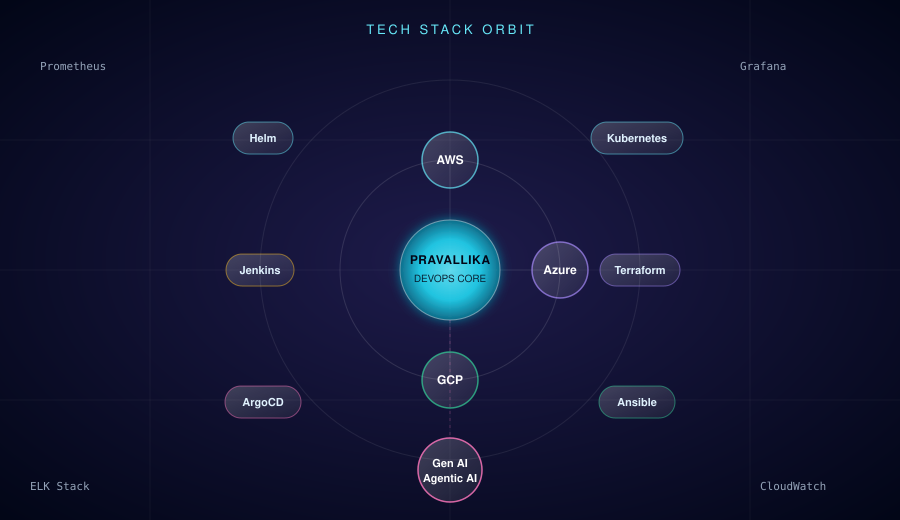
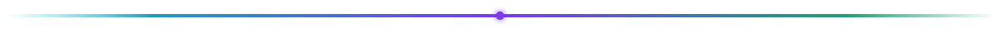

  

  

 

<!-- ============ GLASS CARD: ABOUT ============ -->

## 🪟 About

DevOps Engineer with **3+ years** of experience designing and automating cloud infrastructure on **AWS**. I build CI/CD pipelines, containerise and orchestrate workloads on Kubernetes, and bake security scanning directly into the delivery pipeline rather than bolting it on afterwards.

Alongside production-style project work, I actively build and ship AI-powered DevOps tooling — from GitOps-deployed EKS workloads to Bedrock-backed automation — and document what I learn along the way.

 

## 📊 By the Numbers

<table>
<tr>
<td align="center" width="150" style="background: rgba(34,211,238,0.06); backdrop-filter: blur(16px); border:1px solid rgba(148,163,184,0.25); border-radius:14px; padding:16px;">
<b>3+ Years</b> Experience
</td>
<td align="center" width="150" style="background: rgba(167,139,250,0.06); backdrop-filter: blur(16px); border:1px solid rgba(148,163,184,0.25); border-radius:14px; padding:16px;">
<b>AWS</b> Primary Cloud
</td>
<td align="center" width="150" style="background: rgba(52,211,153,0.06); backdrop-filter: blur(16px); border:1px solid rgba(148,163,184,0.25); border-radius:14px; padding:16px;">
<b>4</b> Production-grade Projects
</td>
<td align="center" width="150" style="background: rgba(34,211,238,0.06); backdrop-filter: blur(16px); border:1px solid rgba(148,163,184,0.25); border-radius:14px; padding:16px;">
<b>Trivy · SonarQube · </b> DevSecOps
</td>
<td align="center" width="150" style="background: rgba(167,139,250,0.06); backdrop-filter: blur(16px); border:1px solid rgba(148,163,184,0.25); border-radius:14px; padding:16px;">
<b>Bedrock · SageMaker</b> AIOps
</td>
</tr>
</table>

 

<!-- ============ GLASS CARD: CURRENT FOCUS ============ -->

## 🎯 Current Focus

- 🤖 **Building** AIOps projects powered by AWS Bedrock and SageMaker
- 🔐 **Deepening** DevSecOps practice — Trivy, SonarQube, OWASP ZAP, External Secrets Operator
- ☸️ **Sharpening** Kubernetes and GitOps skills across EKS, Helm, and ArgoCD
- ✍️ **Writing** real-world DevOps scenarios and lessons on Medium
- 🚀 **Open to** DevOps · DevSecOps · SRE · Platform Engineering roles

 

<!-- ============ GLASS CARD: GEN AI & AGENTIC AI ============ -->

## 🤖 AIOps &amp; Generative AI

Extending my DevOps foundation into the AI layer — using LLMs to make pipelines and platform operations smarter, not just faster.

- **AI-powered Automation** — Bedrock Nova Lite and Bedrock Claude wired into real workloads for triage and remediation
- **ML-assisted Ops** — SageMaker risk scoring integrated into CI/CD and platform decisions
- **Secure by Design** — External Secrets Operator and Secrets Manager keeping AI workloads credential-safe
- **Cost-aware AI** — Lambda + Bedrock + Cost Explorer patterns for FinOps-driven automation

`AWS Bedrock` `SageMaker` `Python` `EKS` `ArgoCD`

 

## 🛠️ Technology Stack

 

<table>
<tr>
<td valign="top" width="50%" style="background: rgba(34,211,238,0.05); backdrop-filter: blur(18px); border:1px solid rgba(148,163,184,0.25); border-radius:16px; padding:18px;">

**☁️ Cloud Platforms**

**⚙️ DevOps & Orchestration**

</td>
<td valign="top" width="50%" style="background: rgba(167,139,250,0.05); backdrop-filter: blur(18px); border:1px solid rgba(148,163,184,0.25); border-radius:16px; padding:18px;">

**📈 Monitoring & Observability**

**💻 Programming & Scripting**

**🔐 DevSecOps**

**🤖 AIOps**

</td>
</tr>
</table>

 

## 🧭 Areas of Specialisation

| Area | Focus |
|---|---|
| **CI/CD & GitOps** | Jenkins and GitHub Actions pipelines auto-synced to EKS via ArgoCD |
| **Infrastructure as Code** | Terraform modules and remote state for repeatable, auditable provisioning |
| **Containers & Kubernetes** | Docker multi-stage builds, EKS, Helm, cert-manager, RBAC |
| **DevSecOps** | Shift-left scanning with SonarQube, Trivy, OWASP ZAP, and External Secrets Operator |
| **AIOps** | Bedrock Nova Lite, Bedrock Claude, and SageMaker wired into real pipelines |
| **Observability** | Prometheus, Grafana, EFK Stack, CloudWatch, and Athena SQL |
| **Cloud Cost & FinOps** | Lambda + Bedrock + Cost Explorer automation for spend visibility |

 

## 📈 GitHub Analytics

 

 

## 🚀 Featured Projects

**[MediBot — AI-Powered Patient Triage System](https://github.com/pravalliika/medibot)**
Jenkins → Trivy → SonarQube gate → Nexus → ECR → ArgoCD → EKS, with AI triage via Bedrock Nova Lite and full Prometheus/Grafana monitoring.
`Jenkins` `Trivy` `SonarQube` `Bedrock Nova Lite` `EKS` `ArgoCD`

**[ComplianceIQ — AI-Powered Compliance Automation](https://github.com/pravalliika/complianceiq)**
6 microservices on AWS EKS with SageMaker risk scoring, Bedrock Claude remediation, and zero secrets in Git via External Secrets Operator.
`EKS` `SageMaker` `Bedrock Claude` `ArgoCD` `External Secrets`

**[K8s Ecommerce Microservices CI/CD](https://github.com/pravalliika/k8s-ecommerce-microservices-cicd)**
GitOps microservices on AWS EKS with GitHub Actions → ECR → ArgoCD auto-deploys, Terraform-provisioned infra, and full EFK + Grafana + Prometheus observability.
`EKS` `Terraform` `GitHub Actions` `ArgoCD` `EFK` `Grafana`

**[AWS Log Analytics — CloudWatch & Athena](https://github.com/pravalliika/aws-log-analytics-cloudwatch-athena)**
Serverless log pipeline from CloudWatch Agent to S3 to Athena SQL, capturing CloudTrail events to detect failed logins, IAM anomalies, and S3 activity.
`CloudWatch` `Athena` `S3` `CloudTrail`

 

<!-- ============ GLASS CARD: WRITING ============ -->

## ✍️ Latest Writing

Real-world DevOps scenarios, project breakdowns, and lessons from hands-on builds — published on [Medium](https://medium.com/@pravallika96973).

 

<!-- ============ GLASS CARD: 2026 GOALS ============ -->

## 🎯 2026 Goals

- 🏆 Land a DevOps / DevSecOps / SRE role at a product-based company
- 📜 Earn the AWS Certified DevOps Engineer – Professional certification
- 🤖 Ship more AIOps projects with Bedrock and SageMaker
- ✍️ Publish real-world DevOps articles on Medium
- 🌟 Contribute to open-source cloud-native projects
- 🏅 Earn CKA — Certified Kubernetes Administrator

 

<i>"I don't just run pipelines — I build infrastructure teams trust in production."</i>
 
— Pravallika Medisetti

