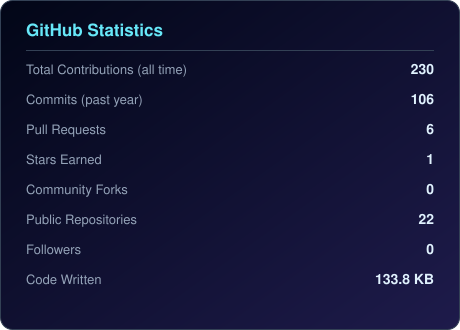
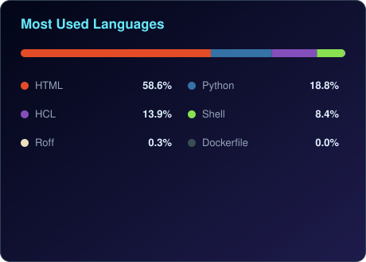
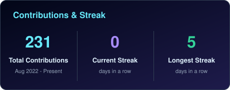

 

  

LinkedIn Medium Email GitHub Profile Views

   <!-- ============ GLASS CARD: ABOUT ============ --> 

🪟 About

DevOps Engineer with 3+ years of experience designing and automating cloud infrastructure on AWS. I build CI/CD pipelines, containerise and orchestrate workloads on Kubernetes, and bake security scanning directly into the delivery pipeline rather than bolting it on afterwards.

Alongside production-style project work, I actively build and ship AI-powered DevOps tooling — from GitOps-deployed EKS workloads to Bedrock-backed automation — and document what I learn along the way.

  
📊 By the Numbers

 <table> <tr> <td align="center" width="150" style="background: rgba(34,211,238,0.06); backdrop-filter: blur(16px); border:1px solid rgba(148,163,184,0.25); border-radius:14px; padding:16px;"> <b>3+ Years</b> Experience </td> <td align="center" width="150" style="background: rgba(167,139,250,0.06); backdrop-filter: blur(16px); border:1px solid rgba(148,163,184,0.25); border-radius:14px; padding:16px;"> <b>AWS</b> Primary Cloud </td> <td align="center" width="150" style="background: rgba(52,211,153,0.06); backdrop-filter: blur(16px); border:1px solid rgba(148,163,184,0.25); border-radius:14px; padding:16px;"> <b>4</b> Production-grade Projects </td> <td align="center" width="150" style="background: rgba(34,211,238,0.06); backdrop-filter: blur(16px); border:1px solid rgba(148,163,184,0.25); border-radius:14px; padding:16px;"> <b>Trivy · SonarQube · </b> DevSecOps </td> <td align="center" width="150" style="background: rgba(167,139,250,0.06); backdrop-filter: blur(16px); border:1px solid rgba(148,163,184,0.25); border-radius:14px; padding:16px;"> <b>Bedrock · SageMaker</b> AIOps </td> </tr> </table> 
   <!-- ============ GLASS CARD: CURRENT FOCUS ============ --> 

🎯 Current Focus
🤖 Building AIOps projects powered by AWS Bedrock and SageMaker
🔐 Deepening DevSecOps practice — Trivy, SonarQube, OWASP ZAP, External Secrets Operator
☸️ Sharpening Kubernetes and GitOps skills across EKS, Helm, and ArgoCD
✍️ Writing real-world DevOps scenarios and lessons on Medium
🚀 Open to DevOps · DevSecOps · SRE · Platform Engineering roles

   <!-- ============ GLASS CARD: GEN AI & AGENTIC AI ============ --> 

🤖 AIOps & Generative AI

Extending my DevOps foundation into the AI layer — using LLMs to make pipelines and platform operations smarter, not just faster.

AI-powered Automation — Bedrock Nova Lite and Bedrock Claude wired into real workloads for triage and remediation
ML-assisted Ops — SageMaker risk scoring integrated into CI/CD and platform decisions
Secure by Design — External Secrets Operator and Secrets Manager keeping AI workloads credential-safe
Cost-aware AI — Lambda + Bedrock + Cost Explorer patterns for FinOps-driven automation

AWS Bedrock SageMaker Python EKS ArgoCD

  
🛠️ Technology Stack

  
   <table> <tr> <td valign="top" width="50%" style="background: rgba(34,211,238,0.05); backdrop-filter: blur(18px); border:1px solid rgba(148,163,184,0.25); border-radius:16px; padding:18px;">

☁️ Cloud Platforms

Show Image Show Image

⚙️ DevOps & Orchestration

Show Image Show Image Show Image Show Image Show Image Show Image Show Image Show Image

</td> <td valign="top" width="50%" style="background: rgba(167,139,250,0.05); backdrop-filter: blur(18px); border:1px solid rgba(148,163,184,0.25); border-radius:16px; padding:18px;">

📈 Monitoring & Observability

Show Image Show Image Show Image Show Image

💻 Programming & Scripting

Show Image Show Image

🔐 DevSecOps

Show Image Show Image Show Image

🤖 AIOps

Show Image Show Image

</td> </tr> </table>  
🧭 Areas of Specialisation

 

Area	Focus
CI/CD & GitOps	Jenkins and GitHub Actions pipelines auto-synced to EKS via ArgoCD
Infrastructure as Code	Terraform modules and remote state for repeatable, auditable provisioning
Containers & Kubernetes	Docker multi-stage builds, EKS, Helm, cert-manager, RBAC
DevSecOps	Shift-left scanning with SonarQube, Trivy, OWASP ZAP, and External Secrets Operator
AIOps	Bedrock Nova Lite, Bedrock Claude, and SageMaker wired into real pipelines
Observability	Prometheus, Grafana, EFK Stack, CloudWatch, and Datadog
Cloud Cost & FinOps	Lambda + Bedrock + Cost Explorer automation for spend visibility

 
   
📈 GitHub Analytics

  

  

 

